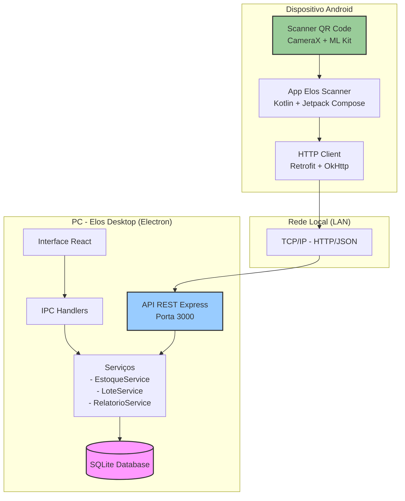

# Diagrama do Sistema Elos + App Mobile



## Fluxo

```mermaid
sequenceDiagram
    participant User as Usuário Android
    participant App as App Scanner
    participant API as API REST (PC)
    participant DB as SQLite (PC)
    
    Note over App,DB: Cenário 1: Ler QR Code e ver detalhes
    User->>App: Escaneia QR Code da etiqueta
    App->>API: GET /api/lote/LOTE-001
    API->>DB: SELECT lote + item
    DB-->>API: Dados do lote
    API-->>App: { item, validade, saldo }
    App-->>User: Exibe detalhes do item
    
    Note over App,DB: Cenário 2: Registrar Saída
    User->>App: Digita quantidade + motivo
    App->>API: POST /api/saida
    API->>DB: INSERT movimentacao
    API->>DB: UPDATE saldo lote
    DB-->>API: Sucesso
    API-->>App: { success, novo_saldo }
    App-->>User: "Saída registrada!"
    
    Note over App,DB: Cenário 3: Contar Inventário
    User->>App: Toca "Contar Inventário"
    App->>API: GET /api/inventario/aberto
    API-->>App: { inventario_ativo }
    User->>App: Escaneia item + digita contagem
    App->>API: POST /api/inventario/contagem
    API->>DB: INSERT/UPDATE contagem
    API-->>App: { success }
    App-->>User: "Contagem salva!"